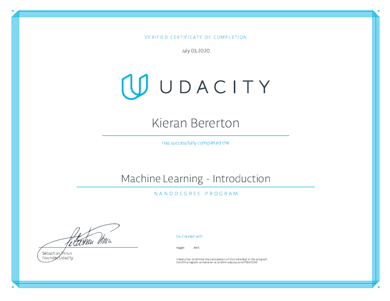

[Home](/)  
[Work Experience](wkexp.html)  
[Robotics - Capstone](capstone.html)  
[Robotics - FRC](robotics.html)  
[Robotics - Mars Rover](spear.html)

# Machine Learning and Artificial Intelligence

This sections documents some examples of my past work in the field of machine learning and artificial intelligence.

## CMPUT 466 - Machine Learning
This elective offered an introduction into the foundational mathematics that govern basic regression and classification models. Topics included:

* Linear Regression  
    * Mean Squared error
    * Gradient Descent
    * Closed-form solution
    * Maximum Likelihood Estimation
    * Maximum a Posteriori Inference
* Linear Classification 
    * Logistic Regression
    * Softmax Regression
    * Naive Bayes
* Neural Networks

The course included a "mini-project" in which we had to apply several machine learning models to a simple problem of our choosing. I chose to generate classification models for the Titanic passengers dataset, the code for and results of which can be seen in this [notebook](466project.html).

## University of Alberta Centre for Smart Transportation
See my [work experience](wkexp.html) page.

## Udacity - Machine Learning Nanodegree
To prevent myself from going insane while stuck in my house over the summer of 2020, I decided the best remedy for that would be to complete a crash course in machine learning. This course offered an introduction to supervised, unsupervised, and deep learning. Each section included small projects such as landmark classification and flower classification.

Throughout the course, I gained experience working with key libraries in Python. I used NumPy and Pandas for data processing, and we used Scikit-Learn and PyTorch machine learning libraries for examples and projects. We also primarily worked in Jupyter notebooks, some of which I have linked below, along with the course certificate.

[Image Classifier Project notebook](./Image%20Classifier%20Project.html){:target="_blank"}  
[Supervised Learning Project notebook](./finding_donors.html){:target="_blank"}

## Using AI to build this portfolio

AI tools were used as a development assistant during the redesign of this website. I provided the goals for the redesign—including the visual direction, the intended audience, the content that needed to be preserved, and the requirement that the site remain straightforward to maintain—and used an AI assistant to help translate those requirements into an implementation.

The work included using AI assistance to:

* Explore and refine the visual direction for the dark, technical interface, taking inspiration from the computer displays and interfaces in *Iron Man* while keeping the result practical and readable.
* Draft and iterate on the site's HTML structure, Jekyll Liquid templates, YAML project data, and responsive CSS.
* Organize the homepage around reusable project-card data and shared layouts, rather than duplicating the same markup across pages.
* Review existing Markdown content and image references while preserving the original project and experience write-ups.
* Troubleshoot implementation issues during preview and testing, including a layout issue that prevented the Markdown content from appearing on individual project pages.
* Improve the maintenance documentation so future content and design changes are easier to make.

AI generated and suggested implementation code and wording, but it did not independently decide what belongs in the portfolio. The direction, requirements, project history, and final review were provided by me. I remain responsible for checking the code, content, links, images, and behaviour of the finished site.

The website itself is a static Jekyll site. It does not use an AI model or an AI-powered feature at runtime; AI was used as part of the development process, not as a service visitors interact with.
